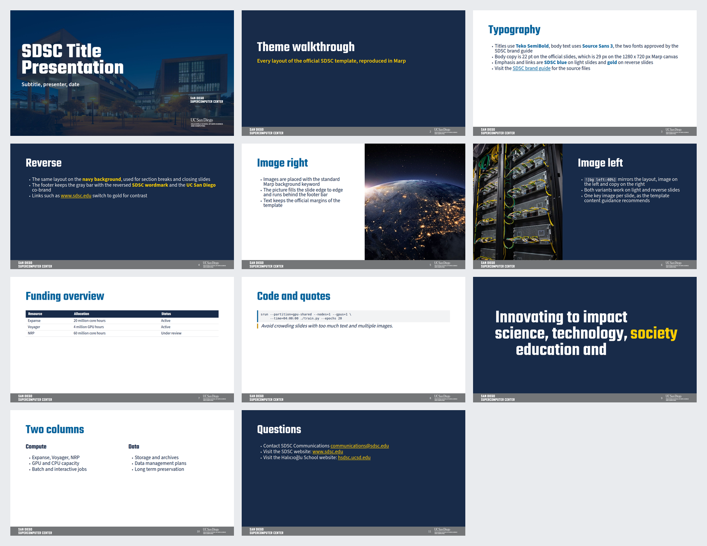

# SDSC Marp theme

A [Marp](https://yhatt.github.io/marp/) theme that reproduces the official
**San Diego Supercomputer Center** slide template (the SDSC / UC San Diego
Halıcıoğlu School of Data Science and Computing PowerPoint template published
at <https://www.sdsc.edu/about/brand.html>, file
`SDSC-UCSanDiego-HSDSC.potx`).

Everything (colours, fonts, geometry, logos, photos) was extracted from that
`.potx` file, not eyeballed, so a Markdown deck and the PowerPoint deck look
the same.



## Preview

| Format | Link |
| --- | --- |
| Interactive HTML preview (11 slides, arrow keys to navigate) | <https://zonca.github.io/sdsc-marp-theme/> |
| PDF of the demo deck | <https://zonca.github.io/sdsc-marp-theme/deck.pdf> |
| Source of the demo deck | [`demo/demo.md`](demo/demo.md) |
| Official template slides, for comparison | [`reference/official/`](reference/official/) |

The preview is published by GitHub Pages from the `preview/` folder
(`.github/workflows/pages.yml`). To rebuild it locally run
`./scripts/build_preview.sh`.

## Installation

Requirements: **Node.js 18 or newer** (for Marp CLI) and the two brand fonts.

1. Install the fonts (both free on Google Fonts): **Teko** for headlines and
   **Source Sans 3** for body text.

   ```bash
   # Linux, system wide
   wget https://github.com/google/fonts/raw/main/ofl/teko/Teko%5Bwght%5D.ttf
   wget https://github.com/google/fonts/raw/main/ofl/sourcesans3/SourceSans3%5Bwght%5D.ttf
   sudo mv Teko*.ttf SourceSans3*.ttf /usr/local/share/fonts/
   fc-cache -f
   ```

   On macOS: download both families from
   <https://fonts.google.com/specimen/Teko> and
   <https://fonts.google.com/specimen/Source+Sans+3> and double-click to
   install.

2. Copy the theme and the assets into your project:

   ```bash
   git clone https://github.com/zonca/sdsc-marp-theme.git
   cp -r sdsc-marp-theme/themes sdsc-marp-theme/assets my-slides/
   ```

   The `assets/` folder holds the official SDSC logos (colour and white
   variants) and the brand photographs used by the demo deck. Keep it next to
   the theme, the CSS refers to it with relative paths.

3. Add the front matter to your deck (`my-slides/deck.md`):

   ```markdown
   ---
   marp: true
   theme: ../themes/sdsc.css
   paginate: true
   size: 16:9
   ---
   ```

4. Render it:

   ```bash
   npx @marp-team/marp-cli deck.md --theme ../themes/sdsc.css --allow-local-files --images png
   npx @marp-team/marp-cli deck.md --theme ../themes/sdsc.css --allow-local-files --pdf
   ```

   `--allow-local-files` is required because the theme references the local
   logos and photos. In Marp CLI 4 the image and PDF outputs are separate
   options, hence the two commands.

### Using the theme without installing the fonts

The deck still renders, but the headlines fall back to a generic sans-serif.
For a quick check of the layout that is enough; for anything public, install
the fonts.

### On hosts where Chrome cannot use its sandbox

Some Linux hosts (Ubuntu 23.10 and newer, and other distributions with the
AppArmor `kernel.apparmor_restrict_unprivileged_userns` restriction) do not
allow the Chrome sandbox, and Chrome aborts with `No usable sandbox!`. Marp
CLI cannot pass `--no-sandbox` to Puppeteer, so point it at a small wrapper
script (see [`scripts/chrome-wrapper.sh`](scripts/chrome-wrapper.sh) in this
repository):

```bash
export CHROME_PATH="$PWD/scripts/chrome-wrapper.sh"
npx @marp-team/marp-cli deck.md --theme ../themes/sdsc.css --allow-local-files --images png
```

## Slide classes

Add the class with a Marp directive at the top of the slide:

```markdown
<!-- _class: reverse -->
```

| Class | Result |
| --- | --- |
| *(none)* | Standard content slide: blue title, navy body, gray footer bar |
| `title` | Title slide: official dusk photo of the SDSC building, white Teko title, co-branded logos bottom right, no footer bar |
| `reverse` | Navy background, white title, light gray body, gold emphasis and links |
| `section` | Navy divider slide, white 60 pt title with a gold subtitle |
| `statement` | Navy slide with one large centred sentence (the "Big Bold Statement" layout) |
| `lead` | Bigger title, no fixed title band |
| `columns` | Helper class for `<div class="columns">` two-column layouts |

Background images use the standard Marp keywords, for example
``. The image runs edge to edge
and the footer bar is drawn on top of it, exactly like the "Image right + copy"
layout of the PowerPoint template.

## Design tokens

Taken from `ppt/theme/theme1.xml` and the slide master of the official
template:

| Token | Value | Use |
| --- | --- | --- |
| Navy | `#182B49` (PMS 2767) | Body text, reverse backgrounds |
| Blue | `#00629B` | Titles on light slides, emphasis, links |
| Gold | `#C69214` (PMS 1245) | Wordmark gold |
| Bright gold | `#FFCD00` | Emphasis and links on reverse slides |
| Footer gray | `#747678` | Footer bar |
| Light gray | `#E7E6E6` | Body text on reverse slides |

Geometry, converted from the 12192000 x 6858000 EMU PowerPoint master to the
1280 x 720 px Marp canvas (1 px = 9525 EMU):

| Element | Value |
| --- | --- |
| Left and right margin | 88 px |
| Title band | starts at 38 px, 154 px tall, title vertically centred |
| Body text | 29 px (22 pt), line height 0.95 |
| Title | Teko 72 px (54 pt), line height 0.8 |
| Footer bar | 52.5 px tall, `#747678` |
| SDSC wordmark (footer) | 192 x 35 px at 46 px from the left |
| UC San Diego / HSDSC logo (footer) | 132 x 35 px at 46 px from the right |
| Title slide logos | 186 px wide at x = 1031 px, y = 496 px and y = 618 px |

## Repository layout

```
sdsc-marp-theme/
├── assets/                 logos (SVG, colour and white variants) and brand photos
├── demo/demo.md            11 slide deck exercising every layout
├── out/                    rendered PNG and PDF of the demo deck
├── preview/                published preview: index.html, deck.pdf, screenshot.png
├── reference/official/     the 10 slides of the official template, rendered for comparison
├── scripts/build_preview.sh    rebuilds the published preview
├── scripts/chrome-wrapper.sh   Chrome launcher that adds --no-sandbox
├── scripts/contact_sheet.py    builds the contact sheet screenshot
├── scripts/inline_assets.py    inlines the assets into the preview HTML
├── scripts/render.sh           renders any deck with the theme
└── themes/sdsc.css             the theme
```

## Notes and deviations from the PowerPoint template

* The PowerPoint master sets a 28 pt body size, but every slide in the
  template uses 22 pt, so the theme uses 22 pt (29 px).
* The "Big Bold Statement" layout is 180 pt in PowerPoint, which only fits a
  couple of words; the theme uses 130 px so a full sentence fits.
* The "Section Header" layout in PowerPoint places the subtitle near the
  bottom of the slide; the theme keeps it right under the title.
* Page numbers are optional (`paginate: true` in the front matter) and are
  placed on the footer bar, to the left of the UC San Diego logo.
* Code blocks and tables have no equivalent in the official template, so they
  use the brand colours (light gray background, blue or gold left border).

## Credits

Official template, logos and photographs: San Diego Supercomputer Center
brand guide, <https://www.sdsc.edu/about/brand.html>. Please follow the brand
rules when reusing the assets (do not stretch, recolour or alter the wordmark,
keep the clear space, and use the white wordmark on dark backgrounds).

The theme code is MIT licensed (see [`LICENSE`](LICENSE)). The logos and
photographs remain the property of the San Diego Supercomputer Center and the
University of California, San Diego, and their use follows the brand guide.
