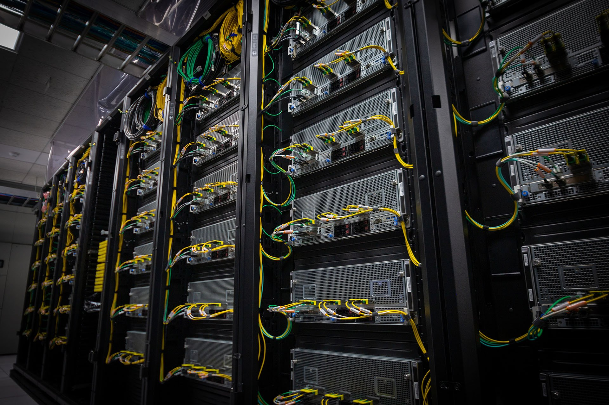

<!-- _class: title -->
<!-- _paginate: false -->

# SDSC Title Presentation

Subtitle, presenter, date

---

<!-- _class: section -->

# Theme walkthrough

Every layout of the official SDSC template, reproduced in Marp

---

# Typography

- Titles use **Teko SemiBold**, body text uses **Source Sans 3**, the two fonts approved by the SDSC brand guide
- Body copy is 22 pt on the official slides, which is 29 px on the 1280 x 720 px Marp canvas
- Emphasis and links are **SDSC blue** on light slides and **gold** on reverse slides
- Visit the [SDSC brand guide](https://www.sdsc.edu/about/brand.html) for the source files

---

<!-- _class: reverse -->

# Reverse

- The same layout on the **navy background**, used for section breaks and closing slides
- The footer keeps the gray bar with the reversed **SDSC wordmark** and the **UC San Diego** co-brand
- Links such as [www.sdsc.edu](https://www.sdsc.edu) switch to gold for contrast

---

# Image right


- Images are placed with the standard Marp background keyword
- The picture fills the slide edge to edge and runs behind the footer bar
- Text keeps the official margins of the template

---

<!-- _class: reverse -->

# Image left



- `![bg left:40%]` mirrors the layout, image on the left and copy on the right
- Both variants work on light and reverse slides
- One key image per slide, as the template content guidance recommends

---

# Funding overview

| Resource | Allocation | Status |
| --- | --- | --- |
| Expanse | 20 million core hours | Active |
| Voyager | 4 million GPU hours | Active |
| NRP | 60 million core hours | Under review |

---

# Code and quotes

```
srun --partition=gpu-shared --nodes=1 --gpus=1 \
     --time=04:00:00 ./train.py --epochs 20
```

> Avoid crowding slides with too much text and multiple images.

---

<!-- _class: statement -->

# Innovating to impact science, technology, education and **society**

---

# Two columns

<div class="columns">
<div>

### Compute

- Expanse, Voyager, NRP
- GPU and CPU capacity
- Batch and interactive jobs

</div>
<div>

### Data

- Storage and archives
- Data management plans
- Long term preservation

</div>
</div>

---

<!-- _class: reverse -->

# Questions

- Contact SDSC Communications [communications@sdsc.edu](mailto:communications@sdsc.edu)
- Visit the SDSC website: [www.sdsc.edu](https://www.sdsc.edu)
- Visit the Halıcıoğlu School website: [hsdsc.ucsd.edu](https://hsdsc.ucsd.edu)
